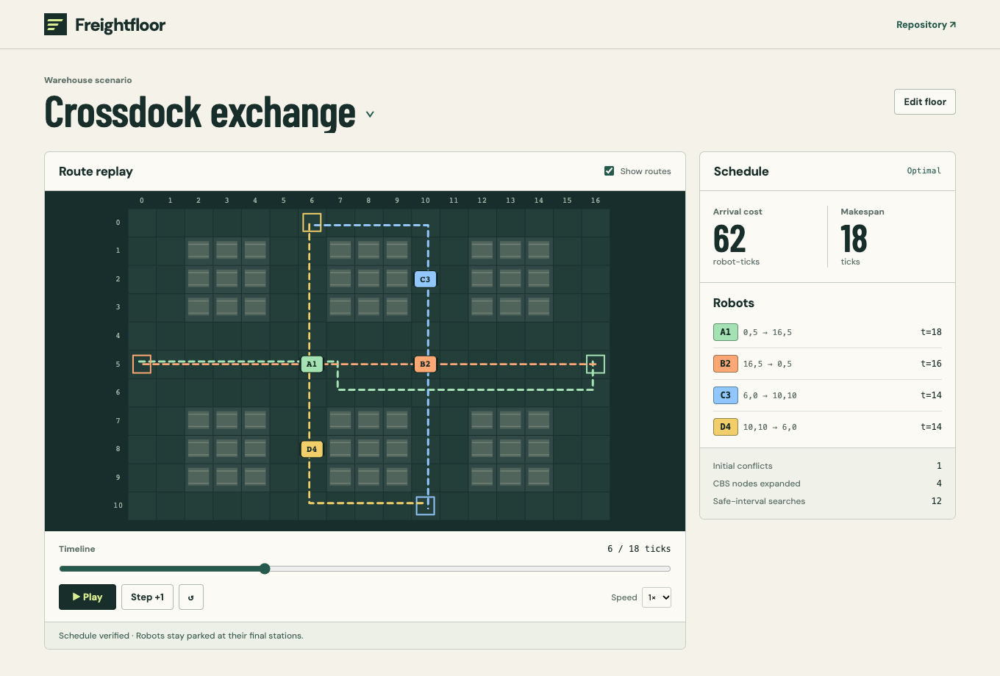

# Freightfloor

A warehouse dispatch console and command-line planner for routing robots through shared aisles. Every robot moves on the same clock, occupies one cell, and stays parked at its goal. Freightfloor minimizes the sum of arrival times within a finite planning horizon and returns paths you can audit and replay.



## Drive the planner

Node.js 20+ is sufficient. There are no runtime packages to install.

```sh
npm test
npm start
# Open http://127.0.0.1:4173
```

Choose a floor, use the timeline to inspect a crossing, or select a robot to isolate its path. **Edit floor** lets you place or remove racks and replan. You can also focus the floor and use arrow keys and Space. Planning runs in a Web Worker, so changing a scenario cancels the old search immediately.

```sh
node src/cli.js examples/passing-bay.json --horizon 20 > plan.json
node src/cli.js examples/passing-bay.json --audit plan.json
# total arrival cost 23; last robot parks at tick 12
```

The crossdock example has four robots. The optimal schedule costs 62 robot-ticks and the final robot parks at tick 18. Arrival cost sums the time at which each robot permanently parks. The latest parking time is the makespan. Only arrival cost is optimized.

## Two levels of search

**Conflict-Based Search (CBS)** initially routes each robot independently. A shared vertex or a head-on edge swap creates a disjunction. Each child forbids that event for a different participant and replans only the affected path. The high-level queue orders nodes by the sum of their shortest admissible paths. For conflict selection it probes up to four candidates and prefers one that raises both children's lower bounds. Both branches remain in the search.

**Safe Interval Path Planning (SIPP)** compresses all legal waiting times at a cell into maximal intervals. An earlier arrival dominates a later arrival in the same interval because the robot can legally wait. A transition must have a legal departure, a legal arrival, and no directed edge reservation at that tick. A terminal goal interval must extend through the horizon. A static BFS distance to each goal is an admissible A* heuristic.

The outcomes are explicit:

| Result | Interpretation |
| --- | --- |
| `optimal` | A collision-free schedule with minimum total arrival cost for the supplied horizon. |
| `infeasible_within_horizon` | Search exhausted the possibilities within that horizon. Increasing it may change feasibility. |
| `node_budget_reached` | Search hit its expansion limit. The returned lower bound applies to unfinished alternatives. |

CBS has exponential worst-case growth. Safe intervals help when long waits dominate, while cached replans trade memory for repeated work. The browser uses a 64-tick horizon and a 10,000-node limit. The CLI accepts `--horizon` and `--nodes`. The model assumes synchronous unit-time steps between neighboring cells and permits waiting. It has no acceleration or turning-radius model.

## Check correctness independently

`npm test` checks 96 deterministic two- and three-robot cases against a joint-state dynamic program. The reference enumerates simultaneous moves and optional permanent parking, independently of CBS and SIPP. A separate replay audit checks boundaries, walls, adjacency, vertex collisions, head-on swaps and objective values. CI also exercises the actual browser worker and controls at desktop and mobile widths.

To run the browser check locally:

```sh
python3 -m venv .venv
. .venv/bin/activate
pip install playwright
python -m playwright install chromium
python checks/browser.py
```

**Experiment.** Load the single passing bay. Two robots must exchange ends of a one-cell-wide aisle. Block the side bay at coordinate (5, 1), then apply the edit and inspect the reported outcome. To get a quick exhaustive impossibility result from the CLI, set a short horizon. Reopen the bay and replay the optimal exchange.

The fonts are bundled for offline use. Barlow Condensed and DM Sans carry the SIL Open Font License, included beside the font files in `web/fonts`.
